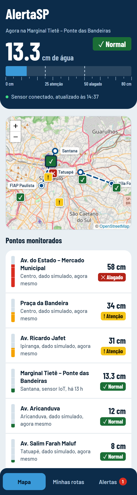
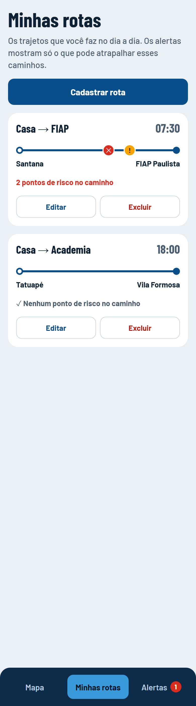
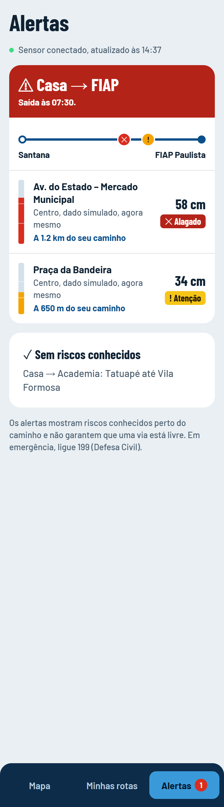
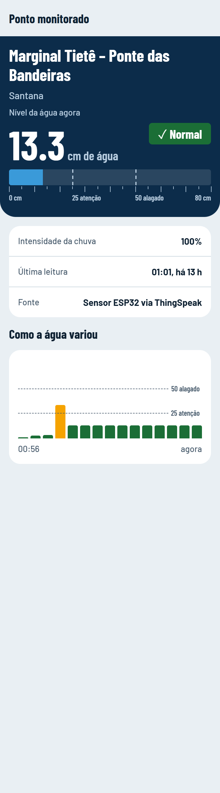
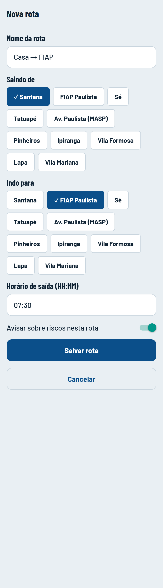

# AlertaSP

> Inteligência que antecipa riscos e protege caminhos.

## Ficha da CitizenTech

| Campo | Resposta |
|---|---|
| **Nome da CitizenTech** | AlertaSP |
| **Cidade e bairro** | São Paulo – foco inicial no eixo Santana → Centro → Av. Paulista (Marginal Tietê) |
| **Cidadão beneficiado** | Trabalhadores e estudantes que fazem o mesmo trajeto todos os dias e são pegos de surpresa por alagamentos (pedestres, motoristas, motociclistas, usuários de ônibus) |
| **Problema, em uma frase** | Quem se desloca em São Paulo só descobre que o caminho está alagado quando já está no meio dele. |
| **Como funciona** | Sensores de nível de água (ESP32) em pontos críticos enviam leituras para a nuvem (ThingSpeak). O app cruza essas leituras com as rotas cadastradas pelo cidadão e avisa quando há risco perto do trajeto, antes da hora de sair. |
| **O que cada parte faz** | **Circuito ESP32 no Wokwi**: mede o nível da água, classifica o risco (Normal/Atenção/Alagado), sinaliza no local (LEDs, LCD, buzzer) e publica no ThingSpeak. **App (este repositório)**: mostra os pontos no mapa, guarda as rotas do usuário no SQLite e gera os alertas personalizados. |
| **Link do repositório** | https://github.com/RicardoDiTilia/alertasp |
| **Indicador de impacto** | Nº de alertas emitidos antes do horário de saída para rotas com ponto em Atenção/Alagado; % de usuários que mudaram horário ou caminho após um alerta (medido por pesquisa com os usuários em um piloto) |
| **ODS conectados** | **ODS 11** – Cidades e comunidades sustentáveis (meta 11.5: reduzir o impacto de desastres sobre as pessoas). **ODS 13** – Ação contra a mudança global do clima (meta 13.1: resiliência a eventos climáticos extremos). |

> **Escuta do cidadão:** _registrar aqui a conversa com uma pessoa real que convive com o problema (quem é, qual trajeto faz, o que faz hoje quando chove, o que atrapalha)._

## Integrantes

| Nome | RM |
|---|---|
| Ricardo Di Tilia | RM555155 |
| Bento Rangel | RM559124 |
| Eric Yuji | RM554869 |
| Kaue Pires | RM554403 |
| Higor Batista | RM558907 |

## Vídeo do app

_preencher com o link do vídeo (até 3 minutos)_

## Telas

| Mapa | Minhas rotas | Alertas | Ponto monitorado | Nova rota |
|---|---|---|---|---|
|  |  |  |  |  |

As versões no tema escuro estão em [`docs/prints/`](docs/prints/).

| Tela | Rota | O que faz |
|---|---|---|
| Mapa | `/` | Mapa com os pontos coloridos por status, rotas do usuário e lista ordenada por gravidade |
| Detalhes do ponto | `/sensor/[id]` | Nível, chuva, horário e fonte da leitura, com histórico recente |
| Minhas rotas | `/rotas` | Lista, edição e exclusão das rotas, com indicação de risco em cada uma |
| Nova/editar rota | `/rota/form` | Formulário: nome, origem, destino, horário de saída e avisos |
| Alertas | `/alertas` | Rotas com pontos em Atenção/Alagado perto do trajeto, priorizando a saída mais próxima |

## Como rodar

Pré-requisitos: Node.js 22+ e, para abrir no celular, o app **Expo Go**.

```bash
npm install
npm start
```

Escaneie o QR code com o Expo Go. Para abrir no navegador, use `npm run web`.

### Conectar ao sensor

Sem configuração, o app roda em **modo demonstração**: o sensor é simulado e o app avisa isso na tela. Para ler um canal do ThingSpeak:

1. Copie `.env.example` para `.env.local`.
2. Preencha `EXPO_PUBLIC_THINGSPEAK_CHANNEL_ID`. Se o canal for privado, preencha também `EXPO_PUBLIC_THINGSPEAK_READ_API_KEY`.
3. Reinicie com `npm start -- --clear`.

## Como os requisitos foram atendidos

- **Telas e navegação**: Expo Router com abas (Mapa, Minhas rotas, Alertas), pilha para detalhes e modal de formulário.
- **Consumo de dados**: `src/services/thingspeak.ts` busca as leituras do sensor ESP32 na API REST do ThingSpeak a cada 20 s.
- **Banco de dados**: `expo-sqlite` com migração versionada (`src/db/index.ts`):
  - `rotas`: cadastro, edição e exclusão das rotas do usuário;
  - `leituras_cache`: últimas leituras do sensor, exibidas quando o app está sem internet.
- **Acessibilidade**: status sempre com cor, símbolo e texto, contraste AA, rótulos para leitor de tela, áreas de toque amplas e linguagem simples.
- **Aderência ao problema**: alertas personalizados por trajeto e horário de saída, sem uso de GPS.

## Arquitetura

```
[ESP32 no Wokwi] --HTTP--> [ThingSpeak] <--HTTPS-- [App Expo]
 HC-SR04 mede o nível       guarda as leituras      mapa, rotas, alertas
 LEDs / LCD / buzzer        (field1..3)             SQLite (rotas + cache offline)
```

| Campo no ThingSpeak | Conteúdo |
|---|---|
| `field1` | nível da água em cm |
| `field2` | status: `0` Normal, `1` Atenção, `2` Alagado |
| `field3` | intensidade de chuva em % |

Limites usados no sensor e no app: **Atenção a partir de 25 cm** e **Alagado a partir de 50 cm**.

### Como os alertas são calculados

`src/utils/alertas.ts` aproxima cada rota pela linha reta entre origem e destino e calcula a distância de cada ponto monitorado até essa linha (`src/utils/geo.ts`). Pontos em Atenção ou Alagado a até **1,5 km** do trajeto entram no alerta. É uma aproximação: o app avisa sobre riscos conhecidos, mas nunca garante que um caminho está livre.

## Fontes de dados

- **Sensor `SP-TIETE-01`**: leituras geradas pelo circuito ESP32 simulado no Wokwi.
- **Demais pontos**: dados **simulados**, identificados como tal no app. As localizações são pontos com histórico conhecido de alagamento em São Paulo (referência: GeoSampa e CGE), com coordenadas aproximadas.
- **Mapa na versão web**: © colaboradores do OpenStreetMap.
- Nenhum dado pessoal real é coletado: o app não usa GPS, e o usuário escolhe origem e destino em uma lista de locais.

## Estrutura

```
src/
  app/                 telas (Expo Router)
    (tabs)/            index (Mapa), rotas, alertas
    sensor/[id].tsx    detalhes do ponto
    rota/form.tsx      criar/editar rota
  components/          componentes de interface e mapa
  context/             leitura dos sensores e rotas do usuário
  data/                pontos monitorados e locais de origem/destino
  db/                  SQLite: migração, rotas, cache de leituras
  services/            cliente do ThingSpeak e simulador do modo demonstração
  utils/               cálculo de alertas, geometria e formatação
```
